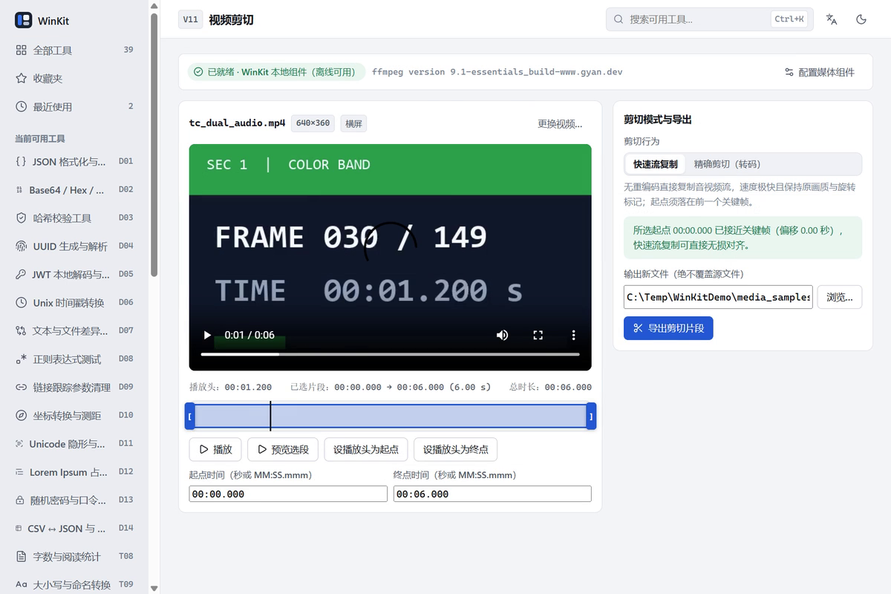
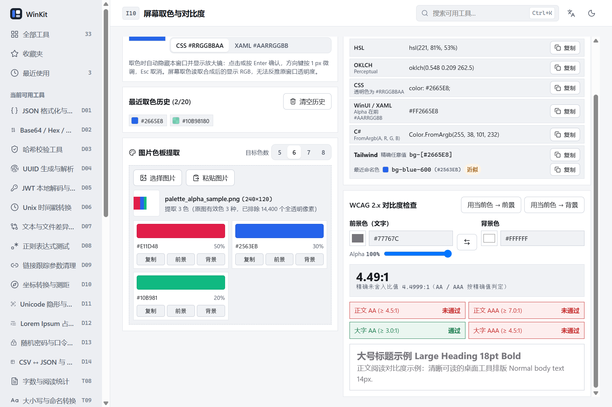
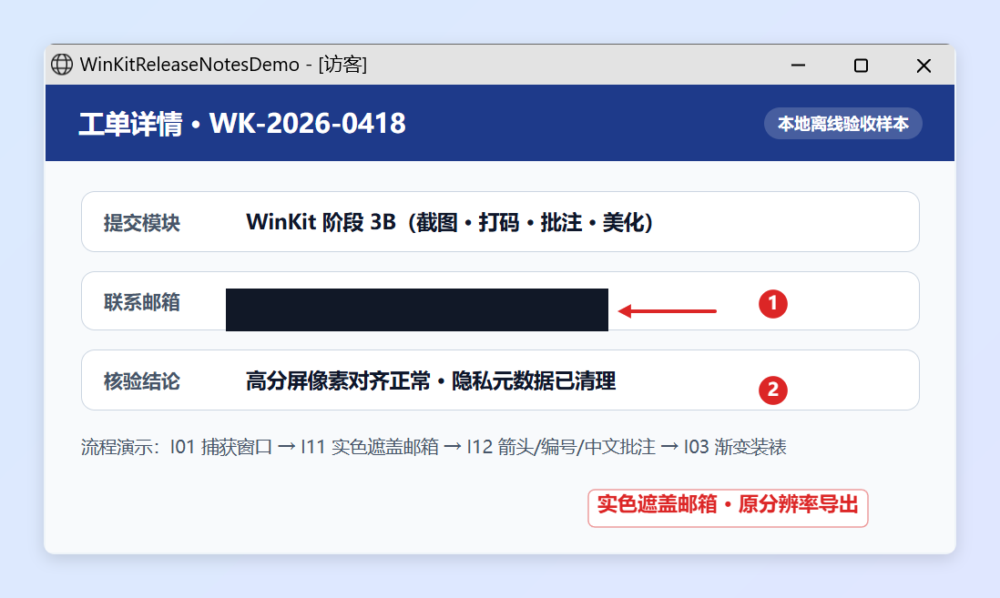
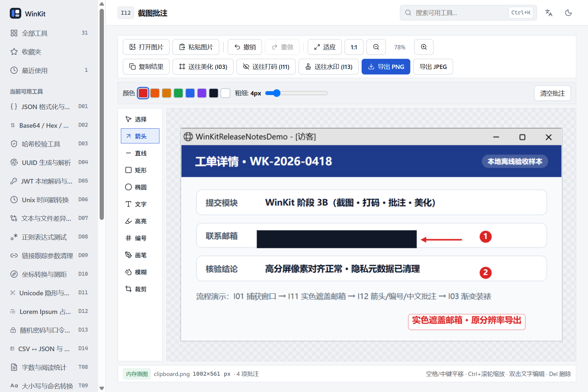

# WinKit

WinKit 是一款面向 Windows 11 x64 的本地优先桌面效率工具箱，基于 Tauri 2 + React + TypeScript + Vite + Rust 构建，提供简体中文与英文界面。全部计算与文件处理均在本机离线完成，不包含遥测、账号体系或云端上传。

## Windows 11 x64 下载与安装

[下载 v0.13.0 安装程序（.exe）](https://github.com/LuckyLivio/WinKit/releases/download/v0.13.0/WinKit_0.13.0_x64-setup.exe) · [SHA256SUMS.txt](https://github.com/LuckyLivio/WinKit/releases/download/v0.13.0/SHA256SUMS.txt) · [v0.13.0 发行说明](https://github.com/LuckyLivio/WinKit/releases/tag/v0.13.0)

1. 下载安装程序和校验文件。在下载目录打开 PowerShell，运行 `Get-FileHash .\WinKit_0.13.0_x64-setup.exe -Algorithm SHA256`，与校验文件中该文件名对应的摘要核对。
2. 关闭正在运行的 WinKit，双击安装程序并选择语言，按提示安装到当前 Windows 用户账户。升级已有版本时使用同一账户。
3. 从开始菜单打开 WinKit。在「视频」「音频」「图片」「文件」「开发者」「文本与语音」中打开 39 项本地工具，亦可按 `Ctrl+K` 即时搜索。

项目当前未配置 Authenticode 代码签名证书，Windows 可能显示“未知发布者”。发行说明记录对应安装程序的签名检查结果。WinKit 需要 Microsoft Edge WebView2 Runtime；如系统缺少此运行时，安装程序会联网获取。离线安装前请先准备好 WebView2。

- **非媒体工具（33 项）**：安装后立即可 100% 离线运行（`I02` / `I11` 随包内置 MIT 许可的 YuNet 人脸框检测 ONNX 模型与纯 Rust `tract-onnx` CPU 推理运行库，不联网下载也不提取身份特征；HEIC 读写通过 Windows 原生 WIC 接口调用系统已安装的 HEIF/HEVC 扩展，缺失时给出明确引导而不报错崩溃）；点击二维码工具中已识别网址上的“在浏览器打开”会将该地址交给系统默认浏览器。
- **音视频工具（6 项：`V10`、`V11`、`V13`、`A04`、`V04`、`V15`）**：使用本机 `FFmpeg` / `ffprobe` 本地处理，**首次配置媒体组件只需 2–3 步**，配置完成后即可长期完全离线运行：
  1. **系统已装 FFmpeg 的电脑（0 步下载，自动就绪）**：直接打开任意视频/音频工具或「设置 → 媒体组件」，WinKit 自动探测并验证 `PATH` 中可用的 `ffmpeg` 与 `ffprobe`，立即进入就绪状态；也可点击「选择本地目录…」指向你自己的 FFmpeg 文件夹。
  2. **全新 Windows 电脑（仅 3 步一次性配置）**：
     - **第 1 步**：打开任意视频/音频工具（如 `V10 媒体信息检测`），或打开「设置 → 媒体组件」，点击「配置媒体组件」；
     - **第 2 步**：查看卡片上明示的固定版本信息（[`GyanD/codexffmpeg` 9.1 Essentials Windows x64](https://github.com/GyanD/codexffmpeg/releases/tag/9.1)，下载包 `34.97 MiB` / `36,671,021` 字节，安装占用 `210.80 MiB` / `221,044,037` 字节，GNU GPL v3，仅写入 `%LOCALAPPDATA%\com.luckylivio.winkit\media-tools\ffmpeg-9.1-essentials`，**不修改系统 `PATH`**）并主动点击「下载并配置媒体组件」；
     - **第 3 步**：等待自动下载、逐字节校验 SHA-256、解压与 `ffmpeg`/`ffprobe` 自检完成后即可使用（下载中途可随时取消重试；配置完成后彻底断网也可正常重启使用全部 6 项音视频工具）。

## v0.13.0 音视频工具操作演示（由 WinKit 自身 V15 / V04 离线生成）

以下动态演示 GIF 与静态封面图均由 WinKit `v0.13.0` 安装版本身离线产出（使用 `V15 视频转 GIF` 双遍调色板导出动图、`V04 视频抽帧` 提取 PNG 封面），展示 `39` 项工具视频分类、`V10 媒体信息检测`、`V11 视频剪切` 实时播放与 `V15 视频转 GIF` 参数工作区（固定版本直链：[v0.13.0-demo.gif](https://raw.githubusercontent.com/LuckyLivio/WinKit/v0.13.0/docs/screenshots/v0.13.0-demo.gif) · [v0.13.0-demo-cover.png](https://raw.githubusercontent.com/LuckyLivio/WinKit/v0.13.0/docs/screenshots/v0.13.0-demo-cover.png)）：


静态封面预览（由安装版 `V04 视频抽帧` 离线提取）：



## v0.12.0 实机工作区实景（150% 高分屏缩放）

真实安装版 `I02 人脸自动打码` 工作区实景（离线 CPU 识别多张合影、未检出人脸与损坏文件状态独立标注，框选可取消、补框、移动和调大小，默认不可逆烘焙并清除隐私元数据）：


真实安装版 `I10 屏幕取色与对比度` 工作区实景（Win32 屏幕放大镜像素取色、8 种 Windows/Web 格式、图片提色自动排除透明像素、WCAG 2.x 未舍入临界对比度判定与半透明合成提示）：



## 截图 → 打码 → 批注 → 美化成品与工作区实景（v0.11.0）

以下成品由 WinKit 离线流水线全程完成（`I01` 窗口捕获 → `I11` 不透明实色遮盖敏感邮箱 → `I12` 箭头/编号/中文批注 → `I03` 渐变背景与圆角阴影装裱），跨工具在内存中传递原始分辨率图像，仅在最终导出或复制时落盘一次：



Windows 11 `150%` 高分屏缩放下真实安装版 `I12 截图批注` 工作区实景（全部工具栏与画布控件可见，中文标签无截断，选区绑定原图像素）：



## v0.13.0 功能

### 桌面工作台与基础设施

- **工具检索与导航**：左侧分类导航、分类筛选（视频 / 音频 / 图片 / 文件 / 开发者 / 文本与语音）、即时关键词搜索（`Ctrl+K`）、收藏夹、最近使用记录（注册表位于 `src/registry/tools.ts`）。
- **外观与双语**：浅色主题（默认）、深色主题与跟随系统切换；简体中文（`zh-CN`）与英文（`en-US`）实时切换与偏好持久化，用户态覆盖升级保留设置。
- **隐私、文件安全与窗口退出闭环**：
  - 工具切换在当前进程内存中保留工作状态（`D13` 生成密码在切换返回时保持掩码显示），默认绝不将用户输入文本、链接、坐标、生成密码、JWT 令牌、共享密钥、差异文本或路径写入磁盘。
  - 原生文件打开/保存对话框与桌面拖放接入，后端强制阻止覆盖源文件、拦截同名静默覆盖，并通过临时文件原子提交避免写出半成品。
  - 统一接入前后端同步关闭准入与 `TaskRegistry`：可能产生文件副作用的任务在排入后台线程前先行登记生命周期 guard；空闲关闭在同一互斥锁内原子置位 `shutting_down` 并终止纯内存前端计算 Worker（`D07`、`D08`、`D10`、`D14`）与在途 FFmpeg 外部子进程后直接销毁窗口；存在运行中任务时弹出单实例确认框，确认退出后阻止新任务进入、通知可中断任务取消并等待文件句柄与短写入安全收尾后再销毁窗口（销毁异常时自动恢复可操作状态）。
- **共用本地媒体组件与范围流式预览**：统一支持自动探测系统 `FFmpeg`/`ffprobe`、手动指定本地目录以及用户主动点击的一次性下载校验安装（固定 `GyanD/codexffmpeg 9.1` Essentials，逐字节核对 SHA-256、先通过 `ffmpeg -version`/`ffprobe -version` 自检再切换生效，绝不改动系统 `PATH`）；内置白名单 `winkitmedia` 协议支持 HTTP Range（`206 Partial Content`）本地流式预览与音轨试听，遇 WebView2 不支持的封装或编码自动回退首帧图并提示“素材完好、并非损坏”。

### 可用本地工具（39 项）

1. **`V04` 视频抽帧**（阶段 4A 完整实现，待用户验收）
   - 支持单时间点、固定间隔（秒）与均匀抽取 N 张三种模式及范围限定，输出 PNG、JPEG、WebP 及在系统已装 WIC 编码扩展时导出 HEIC；采用 VFR 精确保持帧定位策略准确命中所选时刻，提供原分辨率 / 1080p / 720p（默认不放大小视频），自动烘焙竖拍旋转为正立图像，展示缩略图集、随时取消清理临时文件且绝不覆盖已有文件。
2. **`V10` 媒体信息检测**（阶段 4A 完整实现，待用户验收）
   - 基于本机 `ffprobe` 离线解析容器、时长、文件大小、总码率、视频编码/像素格式/编码尺寸与旋转后显示尺寸（标注横竖屏）/帧率与 CFR/VFR 判定、每条音轨（编码/语言/标题/声道/采样率/码率）、字幕流与标签；支持复制可读文本摘要、复制或导出完整 JSON，并可一键将当前文件送入 `V11` / `V13` / `A04` / `V04` / `V15`。
3. **`V11` 视频剪切**（阶段 4A 完整实现，待用户验收）
   - 内置视频播放器、可拖动时间轴与起止时间精确输入（支持按播放头设起点/终点与选段预览）；明确区分「快速流复制（无重编码）」与「精确剪切（重编码）」，导出前实时探测起点关键帧并如实提示流复制偏移范围；保持竖拍方向与音画同步，强制禁止覆盖源文件或已有目标并支持中途取消清理 `.tmp`。
4. **`V13` 视频静音**（阶段 4A 完整实现，待用户验收）
   - 支持单视频与多视频批量通过 `-map 0:v -an -c:v copy` 无重编码移除全部音轨（含多音轨视频），导出后自动经 `ffprobe` 二次确认音轨数为 `0`；原本无音轨视频如实标注且不重复写出，单条失败不影响批次其余项，始终防覆盖输出并支持切换工具保留进度与随时取消。
5. **`V15` 视频转 GIF**（阶段 4A 完整实现，待用户验收）
   - 支持整段或指定起止范围、帧率（`10` / `15` / `24` fps）、目标宽度（`320` / `480` / `640` / 原宽，默认不放大小视频）与无限循环 / 仅播放一次开关；通过 `palettegen=stats_mode=diff` + `paletteuse=dither=sierra2_4a` 双遍高质量调色板编码并正确处理竖拍旋转，导出后立即展示真实帧数、尺寸、体积与动图预览。
6. **`A04` 提取视频音频**（阶段 4A 完整实现，待用户验收）
   - 支持单视频与批量视频将音轨导出为 **M4A、MP3、WAV 或 FLAC**；多音轨视频列出语言/标题/编码/声道/码率并提供 30 秒片段直接试听选轨；当源编码与目标容器兼容时自动优先无损直拷并明确标注「无损直拷 / 重编码」，无音轨视频清晰提示跳过且绝不生成空文件。
7. **`D01` JSON 格式化与校验**（完整覆盖原版公开基线，待用户验收）
   - 支持对象、数组与合法 JSON 标量的 2 空格 / 4 空格 / Tab 格式化、单行压缩与语法校验，1 基精确行列定位，无损保留超 `2^53 - 1` 大整数与小数位字面量，支持按键排序与本地 `.json` 打开/另存。
8. **`D02` Base64 / Hex / 二进制编解码**（部分实现：单次文本上限 `2 MiB`、原始字节小文件上限 `8 MiB`）
   - 支持标准 Base64、URL-Safe Base64、十六进制与 8 位二进制编码/解码（注：数据编码并非加密），提供 64/76 列换行、`=` 填充与空白控制、1 基字符偏移报错、非 UTF-8 原始字节十六进制预览与防覆盖另存。
9. **`D03` 哈希校验工具**
   - 对文本或最多 1,000 个文件计算 MD5、SHA-1、SHA-256、SHA-384 和 SHA-512。支持逐文件核对摘要（含分组十六进制）、取消、在同一会话中继续、重试失败项、批量复制及 CSV 导出。文件计算中可转到文本模式，清空文本后仍可返回查看原批次的结果。
10. **`D04` UUID 生成与解析**（完整覆盖原版公开基线，待用户验收）

- 采用操作系统密码学安全随机源（CSPRNG）批量生成 RFC 9562 UUID `v4` 与毫秒时间序 `v7`（单批 1–500 个），支持大小写与连字符切换，并可解析任意 UUID 的规范格式、版本、变体、Nil/Max 与 `v7` 内嵌时间戳（不为 `v4` 编造时间）。

11. **`D05` JWT 本地解码与验签**（完整覆盖原版公开基线，待用户验收：上限 `256 KiB` 令牌 / `64 KiB` 密钥）

- 离线解析三段式 JWS/JWT（大整数零损保真，自动识别 `Bearer ` 与成对引号）与五段式加密 JWE 保护头（仅读头部不解密）；严格分离展示结构解码、签名校验与 NumericDate（`exp`/`nbf`/`iat`）实时时间窗口状态；支持基于原始 `header.payload` 片段的 `HS256` / `HS384` / `HS512` 恒定时间验签（支持 UTF-8 与显式 Base64/Base64url 密钥，拦截未支持 `crit` 扩展，区分 `alg=none` 未签名，公钥算法仅解码不验签）。

12. **`D06` Unix 时间戳转换**（部分实现：核心四级精度与夏令时校验已闭环）

- 基于 `BigInt` 精确整数运算（零 `Number` 舍入）支持秒、毫秒、微秒、纳秒与 `UTC`、本机时区、指定有效 IANA 时区的 ISO 8601 双向转换；严格拒绝非法闰日及无偏移输入下的夏令时跳变缺失或重复歧义时刻。

13. **`D07` 文本与文件差异对比**（部分实现：每侧上限 `4 MiB / 50,000 行`，较原版公开 `200,000 行` 存在规模差异）

- 支持左右文本与 UTF-8 文件对比（识别并保留 BOM、CRLF/LF、末尾无换行，拦截二进制与 UTF-16 文件，支持双文件按序拖放）、并排与内联视图、行内词/字符级高亮、上下文折叠、前后差异导航、忽略空白/大小写过滤（保留原文），以及始终从原始 A/B 生成并可精确还原 B 的 Unified Diff 复制与 `.patch` 另存。

14. **`D08` 正则表达式测试**（部分实现：采用明确标注的 ECMAScript 正则语义，与参考版 ICU 正则存在语法及超时局部结果策略差异）

- 编译、匹配与替换全部隔离在独立 Web Worker 中执行，主线程设 `2,000 ms` 硬终止预算（`worker.terminate()`）防灾难性回溯卡死；正确推进 Unicode 代理对零宽全局匹配，按 0 基 UTF-16 代码单元区间与 1 基行列展示匹配与编号/命名捕获组，支持 `$<name>` 等 JS 替换预览与复制（上限：表达式 `16,384` UTF-16 代码单元、测试文本 `2 MiB`、单次收集 `2,000` 处匹配）。

15. **`D09` 链接跟踪参数清理**（阶段 2B2/2B3 部分实现：本地清理与解包已闭环，全局剪贴板持续监听归阶段 8；上限 `1 MiB / 5,000 行`）

- 基于本地规则库（`2026.11-r1`）离线剥离 `utm_*`、`fbclid`、`gclid`、`msclkid` 等通用参数及严格域名边界下的站点专属跟踪参数（YouTube/Spotify `si`、Instagram、TikTok、Amazon、X 状态页等），原样保留其余查询原始编码；在首次解包前及进入每层包装前均先行检查疑似签名字段并命中即原样保留；离线逐跳解包 Google、Facebook、Instagram、Outlook Safe Links、LinkedIn 包装（最多 5 层），并提供一次性剪贴板读取预览与纯链接替换。

16. **`D10` 坐标转换与测距**（阶段 2B3 部分实现：离线坐标转换、椭球测距与有限批量导出已闭环；在线底图、地址搜索/反查与定位留后续确认）
    - 支持二维 WGS 84 地理坐标解析与 8 种标准格式导出（`DD`、`DMS`、`DM`、`GeoJSON Point` `[经度, 纬度]`、`WKT POINT (经度 纬度)`、`geo:纬度,经度`、官方 `Apple Maps` 与 `Google Maps` 坐标链接，带分秒进位与未舍入内部坐标隔离），基于本地打包 `geographiclib-geodesic@2.2.0` 计算 WGS 84 参考椭球逆测地线距离（`km`/`m`/`mi`），并在独立 Worker 中提供有限批量坐标转换与含失败记录的 CSV 导出（预算：单点/单行 `16 KiB`、批量输入 `1 MiB / 5,000 行`、批量输出 `8 MiB`）。
17. **`D11` Unicode 隐形与混淆字符检查**（部分实现：基于离线 Unicode 16.0.0，上限 `512 KiB / 50,000 码点`）
    - 离线逐码点展示码点序号、UTF-16 偏移、UAX #29 字素簇序号、`U+XXXX`、官方名称（含汉字、Hangul、控制符别名、`<private-use>` 与 `<reserved>`）、类别、文字系与 UTF-8 字节，标出 BOM、非连接零宽符、连接符/变体选择符、双向控制符、非常规空白、控制符、组合符及 UTS #39 单码点视觉原型候选（标“可能混淆”，不承诺识别全部欺骗文本），支持双向定位、注意项筛选及默认保留 Emoji ZWJ / 波斯语 ZWNJ 的可预览清理与另存。
18. **`D12` Lorem Ipsum 占位文本生成**（阶段 2B2 完整覆盖原版公开基线，待用户验收）
    - 基于本地固定古典拉丁语词表按词（`1–5,000`）、句（`1–500`）、段（`1–100`）离线生成纯文本、HTML `<p>` 段落或 Markdown 占位文本，经典开头严格计入请求总数且 HTML 标签不计入正文词数，支持重新生成、复制与清空。
19. **`D13` 随机密码与口令短语生成**（阶段 2B2/2B3 完整覆盖原版公开基线，待用户验收）
    - 采用操作系统 CSPRNG 无偏拒绝采样生成随机密码（`8–128` 字符，`A–Z`/`a–z`/`0–9`/符号，支持排除易混字符 `0Oo1lI|` 与必含所选类别有界拒绝采样）与英文词表口令短语（Passphrase，`3–12` 词，EFF `7,772` 纯字母词表 `CC-BY-4.0` 独立有放回抽样、分隔符、首字母大写与末尾两位随机数），单批 `1–50` 条，默认掩码展示、绑定配置快照隔离过期异步响应并给出按生成模型估算的熵与强度说明。
20. **`D14` CSV ↔ JSON 与 Markdown 表格转换**（阶段 2B2/2B3 完整覆盖原版公开基线，待用户验收：输入上限 `8 MiB` / 增量 UTF-8 输出上限 `16 MiB`）
    - 在独立可取消 Web Worker 中执行 **CSV ↔ JSON** 互转及 **CSV / JSON → Markdown 表格** 导出；在分配/补齐前先行校验总单元格预算（含表头共 `1,000,000` 单元格）并在生成期增量累计 UTF-8 字节超限即时停止；采用 RFC 4180 状态机与无损 JSON AST 全链路保真超 `2^53` 大整数、精确小数与 `00123` 前导零字符串，支持嵌套对象 `address.city` 展开与点号键冲突处理、标量数组分号/紧凑 JSON 双策略，以及可选前置 `'` 电子表格公式保护预览与防覆盖安全另存。
21. **`T08` 字数与阅读统计**（完整覆盖原版公开基线，待用户验收）
    - 基于 Unicode 字素簇（Grapheme）统计含/不含空白字符，基于 `Intl.Segmenter` 统计中英文词数与句数，固定空文本/CRLF/行数/段落口径，展示 UTF-8 字节、预计默读/朗读时长估算与停用词过滤前 10 高频词（上限 `2 MiB`）。
22. **`T09` 大小写与命名转换**（完整覆盖原版公开基线，待用户验收）
    - 支持 `UPPERCASE`、`lowercase`、`Title Case`、`Sentence case`、`camelCase`、`PascalCase`、`snake_case`、`CONSTANT_CASE`、`kebab-case`、`dot.case`、`alternating`、`inverse` 全部 12 种样式，按行保留换行边界且不覆盖原始输入。
23. **`I01` 屏幕截图与长截图**（阶段 3B1 完整实现，待用户验收）
    - 提供区域（原生全虚拟屏冻结框选，`Esc`/右键取消）、指定窗口（基于 `PrintWindow(PW_RENDERFULLCONTENT)` 捕获被其他窗口部分遮挡的完整内容，严格遵守 Windows `GetWindowDisplayAffinity` 受保护内容限制）、指定显示器与滚动长截图四种模式，支持倒计时与指针开关，自动排除 WinKit 自身窗口、选区浮层与倒计时提示。
    - 滚动长截图支持框选真实滚动区域后自动向下滚动、按相邻画面重叠内容拼接（自动过滤固定吸顶栏与右侧滚动条），到达底部、用户按停止、无法可靠对齐或触及尺寸上限时明确说明停止原因；若仅得到部分长图可先预览再显式选择保留或放弃，停止/取消后立即停止发送滚动事件。支持写入原生 Windows 双格式图片剪贴板（`PNG` + `CF_DIB`）、保存 PNG/JPEG，或零落盘直接以原始分辨率送入 `I03`、`I11`、`I12`、`I13`。
24. **`I02` 人脸自动打码**（阶段 3B2 完整实现，待用户验收）
    - 完全离线运行（断网、空缓存、普通 CPU 可直接使用）：随安装包内置 MIT 许可的 OpenCV Zoo YuNet 人脸框检测 ONNX 模型（`232,589` 字节，加载时裁剪关键点输出，仅做 2D 人脸框定位，不提取身份特征）与纯 Rust `tract-onnx 0.23.10` 推理引擎。
    - 支持单张合影或批量照片拖入，自动先按 EXIF 方向矫正再检测人脸，直接在原图画布上显示可编辑选区框（逐脸取消、手动补框、移动、8 控制点调大小、撤销/重做与前后对照）；提供高斯模糊、像素化与不透明实色遮盖及强度调节，单批明确区分“检测到 N 张脸 / 未检测到人脸 / 检测失败”，批量导出不覆盖源图并默认复用 `I09` 清除隐私元数据，支持中途取消（自动清理 `.tmp`）及将已烘焙结果零落盘送入 `I12` / `I03` / `I13`。
25. **`I03` 截图美化**（阶段 3B1 补齐完整基线，待用户验收）
    - 保留原有 `I03` 入口与纯色背景、留白、SDF 抗锯齿圆角、柔和阴影及 `原图` / `1:1` / `16:9` 画布；新增线性渐变背景（预设/自定义起止色/角度）、自选本地背景图（居中 Cover 裁切与实时预览一致）、`4:5` 与 `9:16` 画布比例、多图批量套用同一配置、剪贴板粘贴/复制与跨工具内存原图交接，小图与超长滚动截图均完整呈现构图不变形。
26. **`I05` 图片格式转换**（阶段 3A 完整实现，待用户验收）
    - 批量将图片转换为 **JPEG、PNG、WebP、TIFF、BMP**，并在当前 Windows 11 系统已安装 HEIF/HEVC 扩展时通过原生 Windows WIC 接口支持 **HEIC 读取与导出**（支持手机 HEIC 批量转 JPG，缺失系统扩展时在界面与结果项中明确提示，不静默失败）。
    - 支持有损格式质量滑块、WebP 无损切换，以及透明图转为 JPEG/BMP 时的自定义背景填充色与实时预览；严格防覆盖输出到独立目录，同名来源自动生成不重名文件，动图与多页 TIFF 明确提示仅导出首帧/首页。
27. **`I06` 图片压缩**（阶段 3A 完整实现，待用户验收）
    - 本地批量压缩 **JPEG、PNG、WebP**，提供低 / 中 / 高三档压缩预设，PNG 明确区分「无损优化（`oxipng`）」与「有损调色板压缩（256 色量化 + `oxipng`）」两种模式。
    - 主预览区内置可拖动的前后细节对比滑块与实时压缩前后体积及节省率估算；已压缩小图若重编码后未能缩小体积，自动保留原始字节（标记「保留原件」），绝不负优化，且原文件保持只读不改。
28. **`I07` 图片批量缩放**（阶段 3A 完整实现，待用户验收）
    - 支持按**百分比**、**最长边像素**与**指定宽高**三种模式批量缩放（高质量 Lanczos3 重采样），默认开启「保持宽高比」与「不放大更小的图片」（超过目标时跳过重编码并标记保留原尺寸）。
    - 先按 EXIF 方向矫正为实际显示宽高再计算目标尺寸并实时预览每张图的导出像素；自动保留常见色彩配置并在批处理中支持切换工具保留进度与随时取消。
29. **`I08` 图片旋转与翻转**（阶段 3A 完整实现，待用户验收）
    - 支持左转 90°、右转 90°、旋转 180°、水平翻转与垂直翻转，可按点击顺序自由组合、逐步撤销与一键重置，主预览区实时渲染最终朝向与交换后的宽高。
    - 预览与导出均先按 EXIF 方向矫正再烘焙为正立像素（导出 `Orientation = 1`，不残留旧方向标记），确保界面预览、导出文件与 Windows 照片应用方向完全一致。
30. **`I09` 图片元数据清除**（阶段 3A 完整实现，待用户验收）
    - 采用容器级无损清理（不对像素做重复有损编码），支持 **JPEG、PNG、WebP 与经典 TIFF**，移除 GPS 定位、相机型号、镜头/软件、拍摄时间、EXIF、XMP、IPTC、注释及重复元数据段与尾部附带数据，并在写入前逐项二次复检确保零残留。
    - 默认仅保留正常显示所需信息（单条 `Orientation` 方向标记与 ICC / sRGB / gAMA 色彩配置，可按需取消勾选）；对 BigTIFF、SubIFD/DNG RAW、HEIC、GIF、BMP 等无法可靠容器清理的文件逐项明确报错，绝不计为已清除。
31. **`I10` 屏幕取色与对比度**（阶段 3B2 按 Windows 平台替代方案实现，部分实现 / 待用户验收）
    - 提供原生 Win32 屏幕取色浮层（自动排除 WinKit 自身与浮层窗口，带 11×11 像素放大镜、高对比度中心十字、方向键 1 px 微调、左键/`Enter` 确认、`Esc`/右键取消，显式标注采样值为桌面合成后 sRGB RGB），并支持任意 CSS / XAML / C# 色值直接输入解析与 20 项最近取色历史（内存会话，可清空）。
    - 一键复制 8 种常用 Windows / Web 格式：`HEX`、`RGB`、`HSL`、`OKLCH`、`CSS`（`#RRGGBBAA`）、`WinUI / XAML`（`#AARRGGBB`）、`C# / .NET`（`Color.FromArgb(a, r, g, b)`）及 `Tailwind`（任意色精确值 `bg-[#...]` + 最近官方命名色并显式标“近似”）；支持图片提取 5–8 种主色调（自动跳过完全透明像素，按像素占比排序并可一键设为对比前景或背景）；内置 WCAG 2.x 对比度计算器（按未舍入真实比值判定正文/大字 AA 与 AAA，展示比值向下截断绝不将 `< 4.5` 误显为 `4.50`，半透明前景先与背景合成后计算并展示合成色值）。
32. **`I11` 图片局部打码**（阶段 3B1/3B2 部分实现：手动多区域不可逆打码与本地“查找人脸”自动补框已闭环，自动 OCR 文字检测归阶段 6；待用户验收）
    - 支持打开本地图片、粘贴剪贴板或接收 `I01` / `I12` 内存原图，在同一像素坐标画布中手动框选或点击「查找人脸」复用 `I02` 离线 YuNet 自动添加多处可编辑模糊、像素化或不透明实色遮盖，支持移动、8 控制点缩放、删除、撤销/重做、适应窗口、`1:1` 与平移。
    - 导出、复制或交接至 `I12` / `I03` / `I13` 时将所有遮盖不可逆烘焙为平坦新像素：实色遮盖 100% 替换选区内原始像素，不保留可移除遮罩层或原图缩略图，并默认复用 `I09` 清理导出副本的隐私元数据。
33. **`I12` 截图批注**（阶段 3B1 完整实现，待用户验收）
    - 与 `I11` 共用原图像素坐标与缩放画布引擎，提供箭头、直线、矩形、椭圆、中英文文字（`Microsoft YaHei UI` + 可选底色衬底与行内编辑）、高亮、连续编号（自动递增/重置）、画笔、局部模糊与精确像素裁剪，支持对象选中、移动、缩放、属性修改、删除与撤销/重做。
    - 缩放画布、改变窗口尺寸或切换工具后标注保持对齐与进度留存；复制、导出 PNG/JPEG 或送往 `I03` / `I11` / `I13` 均保持原始分辨率（裁剪时精确输出所选像素区域）。
34. **`I13` 图片水印**（阶段 3B1 部分实现：图片文字/透明 Logo 批处理与单图能力已闭环，PDF 与视频水印分别归阶段 5、阶段 4 跟踪；待用户验收）
    - 支持中英文文字水印与透明 PNG Logo，提供九宫格角落/居中定位、斜向平铺满画布、边距、大小比例、不透明度、倾斜角度与平铺间距设置；批量处理横图、竖图与不同分辨率图片时可逐张切换实时预览实际落位，支持单图内存交接与批量导出新副本（保留透明 PNG 透明通道，同名不覆盖原图，支持取消并自动清理暂存）。
35. **`F01` 二维码生成与识别**
    - 生成链接、文本或 Wi-Fi 二维码。支持中文、emoji、换行、隐藏网络，提供前景色、背景色、尺寸及 L/M/Q/H 纠错设置。默认输出 512 px、M 级、黑码白底，四周保留四个模块的静区。可复制图片、保存 PNG 或导出 SVG。
    - 多选或拖入 PNG、JPEG、WebP 图片，也可主动粘贴剪贴板图片。每批最多 12 张图，每张最多 16 MiB、1,600 万像素，解码超时 10 秒。按来源列出同图中的二维码和条形码，支持复制内容、复制 Wi-Fi 密码及手动打开 HTTP(S) 链接。识别在本机进行，原图、识别内容和密码仅用于当前操作。
36. **`F02` 批量重命名**（完整覆盖原版公开基线，待用户验收：单批上限 `2,000` 个文件）
    - 支持多选文件、多选或从资源管理器拖入文件夹（载入直属普通文件，自动跳过目录联接与符号链接），提供查找替换、正则表达式（含 `$1`、`${name}` 捕获组与 `$$` 转义）、添加前后缀、序号与文件日期（`YYYY-MM-DD`，支持从 `0` 起算与位数补零）及大小写转换（小写 / 大写 / 单词首字母大写），可按文件名自然序、创建时间或修改时间升序排列。
    - 执行前全量校验 Windows 非法字符、句点/空格结尾、DOS 保留设备名、批内大小写不敏感重名及同目录外部同名冲突；后端采用不带覆盖标志的 Win32 `MoveFileExW` 两阶段暂存事务，原生支持仅改大小写与两文件互换名称，中途遇到文件占用或外部新文件出现时自动回滚整批并保护已有文件，执行后支持一键撤销最近批次。
37. **`F03` 重复文件查找**（完整覆盖原版公开基线，待用户验收）
    - 支持多选或从资源管理器拖入多个文件夹递归扫描（自动合并重复路径与父子嵌套目录，默认跳过目录联接与符号链接，支持最低文件大小与包含隐藏项筛选，识别同一物理分配的 NTFS 硬链接且不计入可释放空间，扫描进度在切换工具后完整保留并可取消）。
    - 执行“按字节大小分组 → 首尾各 64 KiB 比对 → 256 KiB 流式整文件 SHA-256”三级筛选（正确处理 `0` 字节空文件与小文件，无权/占用/消失文件记录跳过原因且不中断其余扫描）；默认不勾选待移除项，支持手选及保留最新、最旧、最短路径、指定目录四种预设，每组强制至少保留一份副本；确认后后端重新核对保留副本与待移除文件的物理标识和完整哈希，仅通过原生 COM `IFileOperation`（配合 `PreDeleteItem` `TSF_DELETE_RECYCLE_IF_POSSIBLE` 拦截）移入 Windows 回收站，目标卷或系统设置无法保证回收时自动跳过而绝不永久删除，并明确展示“已移入回收站”数量、大小及回收站仍占用磁盘空间的提示。
38. **`F04` 压缩与解压**（完整覆盖原版公开基线，待用户验收）
    - 完全离线运行（零外部 7-Zip / UnRAR 依赖），提供「解压压缩包」与「创建压缩包」两个工作视图。支持拖入一个或多个压缩包先预览内部文件列表、路径和大小；每个包自动解压至独立目录（同名包也不会混写），支持进度展示、随时取消（取消或异常时自动清理暂存目录）、逐包结果与「打开输出目录」、可选跳过 `.DS_Store` / `__MACOSX`，严格拦截 Zip-Slip、驱动器/UNC 绝对路径、Windows 非法名/保留设备名、符号链接与 4 GiB 实际写入字节上限，密码仅驻留当前操作内存且输错支持重试。
    - 离线格式支持对照：

      | 格式            | 扩展名               | 预览列表 | 解压 | 创建 | 密码 / 说明                                  |
      | :-------------- | :------------------- | :------: | :--: | :--: | :------------------------------------------- |
      | ZIP             | `.zip`               |   支持   | 支持 | 支持 | 支持（AES-256 与 ZipCrypto 兼容解压/创建）   |
      | 7Z              | `.7z`                |   支持   | 支持 |  —   | 支持（含加密文件头预览与解压）               |
      | RAR (RAR4/RAR5) | `.rar`               |   支持   | 支持 |  —   | 支持只读预览与解压（随包附 `unrar-rs` 声明） |
      | TAR             | `.tar`               |   支持   | 支持 |  —   | 不适用                                       |
      | TAR.GZ          | `.tar.gz`, `.tgz`    |   支持   | 支持 | 支持 | 不适用                                       |
      | TAR.XZ          | `.tar.xz`, `.txz`    |   支持   | 支持 |  —   | 不适用                                       |
      | TAR.BZ2         | `.tar.bz2`, `.tbz2`  |   支持   | 支持 |  —   | 不适用                                       |
      | GZ / XZ / BZ2   | `.gz`, `.xz`, `.bz2` |   支持   | 支持 |  —   | 单文件流（与 `.tar.*` 明确区分）             |
      | ISO             | `.iso`               |   支持   | 支持 |  —   | 只读（ISO 9660 / Joliet）                    |

39. **`F05` 下载图片按来源归档**（已按 Windows 文件夹归档方案实现，待用户验收）
    - 仅在用户手动选择本地图片文件夹后运行（绝不自动扫描日常「下载」目录）。本地读取已有 NTFS `Zone.Identifier` 备用数据流中的 `HostUrl` / `ReferrerUrl` 并仅提取域名（即时丢弃完整 URL 与查询参数，绝不写入日志或配置），不读取浏览器历史。
    - 执行前全量预览文件名、识别来源/站点、目标相对路径与冲突原因；支持按域名或可编辑的常用图床 / CDN 到站点映射表命名（严格域边界匹配，如 `pbs.twimg.com → X (Twitter)`）；无来源、元数据不可读或非 NTFS 卷默认保持原位（可显式勾选归入「未知来源」）；确认后逐项复核文件哈希与元数据（跳过预览后被修改的图片），通过不带覆盖标志的 `MoveFileExW(..., 0)` 同卷原子移动并原样保留 `ZoneId` 与安全流，二次运行自动识别已归档图片不再重复套娃，完成后支持打开目标文件夹。

## 项目文档索引

- [阶段路线图 (docs/ROADMAP.md)](./docs/ROADMAP.md)
- [102 项全量功能对照表 (docs/PARITY_MATRIX.md)](./docs/PARITY_MATRIX.md)
- [架构与安全设计 (docs/ARCHITECTURE.md)](./docs/ARCHITECTURE.md)
- [视觉与交互规范 (docs/DESIGN.md)](./docs/DESIGN.md)
- [验证记录 (docs/VERIFICATION.md)](./docs/VERIFICATION.md)
- [阶段交接说明 (docs/HANDOFF.md)](./docs/HANDOFF.md)
- [第三方开源声明 (THIRD_PARTY_NOTICES.md)](./THIRD_PARTY_NOTICES.md)

## 开发、检查与打包命令（兼容 Windows PowerShell 5.1）

在仓库根目录执行：

```powershell
# 严格按锁文件安装前端依赖
npm ci

# 下载并校验本地 I02/I11 YuNet 人脸检测 ONNX 模型（构建期一次拉取并核对 SHA-256，不入源码库）
npm run ensure-face-model

# 启动真实 Windows Tauri 桌面开发窗口
npm run tauri dev

# 前端格式、类型、Lint、单元测试与构建检查
npm run format:check
npm run typecheck
npm run lint
npm test
npm run build

# Rust 格式、Clippy、单元/集成测试与编译检查
cargo fmt --manifest-path src-tauri/Cargo.toml --all -- --check
cargo clippy --manifest-path src-tauri/Cargo.toml --all-targets -- -D warnings
cargo test --manifest-path src-tauri/Cargo.toml
cargo build --manifest-path src-tauri/Cargo.toml

# 生成本地 Windows x64 NSIS 安装程序（产物位于 src-tauri/target/release/bundle/nsis/，不入库）
npm run tauri build -- --bundles nsis
```
